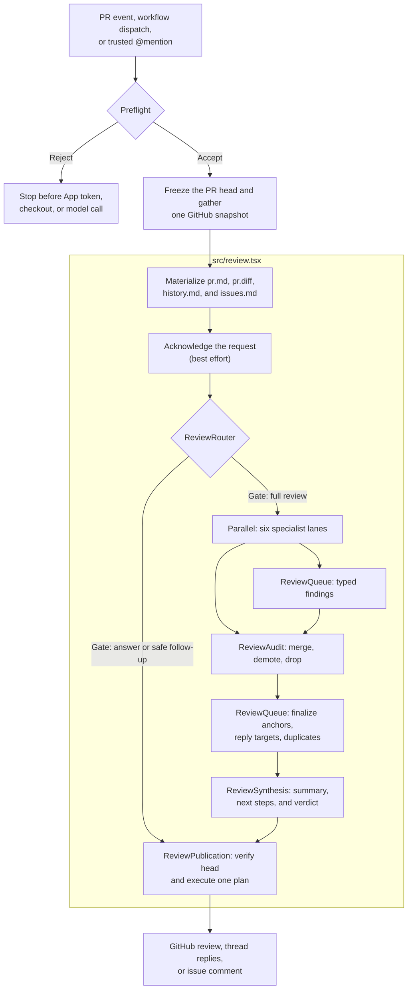

# Review architecture

The [AML tree](../src/review.tsx) expresses model composition. TypeScript owns trusted state and side effects. The [product contract](../PRD.md) defines the guarantees each phase must preserve.

## How a review runs



The `src/review.tsx` section maps directly to the component tree in [src/review.tsx](../src/review.tsx):

```tsx
<Workspace>
  <ReviewContextFiles />
  <ReviewAcknowledgement />
  <ReviewRouter>
    <ReviewSynthesis>
      <ReviewAudit>
        <Parallel>
          <IntentContractLane />
          <StandardsArchitectureLane />
          <CodePathBugHunterLane />
          <CorrectnessRiskTestingLane />
          <DocumentationCommentaryLane />
          <MaintainabilityEleganceLane />
        </Parallel>
      </ReviewAudit>
    </ReviewSynthesis>
  </ReviewRouter>
  <ReviewPublication />
  <ReviewUsageCollection />
</Workspace>
```

AML reads the model tree from the leaves back to the trunk. The nesting defines the review and publication boundaries:

- `<Parallel>` makes the six investigations concurrent and fails the review if any lane fails. Native fragments keep each authored heading and lane in one branch; every lane records typed findings through Tools and returns a short terminal handoff.
- `<ReviewAudit>` explicitly resolves all six children before it freezes the staged queue. It skips the audit Agent when no finding exists and otherwise gives that Agent the ordered lane handoffs, read-only full-comment lookup, and the merge, demote, and drop queue Tools.
- Finding anchors and reply targets are validated when lane Tools add them. `<ReviewSynthesis>` finalizes duplicate and prior-comment handling directly from the queue, runs the typed synthesis Agent, derives the verdict, and returns the composed JSX body to its parent.
- `<ReviewRouter>` is the intentional conditional boundary. It obtains the deterministic or typed gate decision, evaluates only the selected route, and completes one routed body through the request Context API.
- AML evaluates `<ReviewPublication>` next in authored order. Publication reads the completed route, derives the publication draft from it and the queue, verifies that GitHub still points to the reviewed commit, and executes one deterministic write plan.

The shared review Context carries request-scoped dependencies plus small APIs for the typed queue, completed routing handoff, and final publication outcome. Its top-level value is not reactive state: components share the same request binding, and mutable workflow transitions remain behind the owning APIs. Audited and validated snapshots are derived from the queue where they are consumed instead of being copied into phase-owned Context fields.

The [AML source is on GitHub](https://github.com/we-are-singular/aml). Its `Agent`, `Block`, `File`, `Include`, `Parallel`, `Tool`, and `Workspace` components describe the model-facing work without taking ownership of trusted application state.

### The six lanes

| Lane | Question it owns |
| --- | --- |
| Intent and contract | Does the patch satisfy the stated requirement and the strongest active repository contract? |
| Standards and architecture | Does it follow package ownership, canonical sources, repository rules, and established design? |
| Code-path bugs | Can a changed value or state transition break a real caller or consumer? |
| Correctness, risk, and testing | Are security, authorization, data integrity, compatibility, concurrency, rollout, performance, and tests adequate? |
| Documentation and commentary | Do active docs, examples, release guidance, and non-obvious comments still tell the truth? |
| Maintainability and elegance | Is the change locally clear, well placed, and free of needless concepts or indirection? |

Each lane can read the checkout and the same frozen PR evidence. Agents have read-only filesystem permissions, no native shell, and no native network access. Context7 and narrow read-only GitHub tools are available when the change depends on external documentation or linked GitHub evidence. Findings reach the author only through typed review tools.

PRs above 10,000 total added and deleted lines use a local diff of the pinned base/head commits, with only deletion headers shown for wholly deleted files. Historical source inspection is not available through unrestricted shell; a future bounded file-inspection tool must provide that evidence. The application retains complete changed-line ranges for comment validation. Smaller PRs keep their full filtered diff; if GitHub rejects a diff as too large, local Git supplies it without changing the compaction threshold. If local reconstruction is unavailable for a large PR, a complete GitHub diff is used uncompacted, and the review fails only when GitHub also cannot serve it.

Internally, file anchors and snapshot `commentRanges` use sorted inclusive `[start, end]` pairs, with a single line represented as `[line, line]`. This keeps anchor metadata and its serialized representation proportional to ranges rather than individual lines. File inventories still report exact added/deleted line counts, and comment validation rejects ranges that cross lines missing from the diff. The complete raw patch still occupies memory while parsing.

The snapshot includes GitHub closing issues and explicit `related to` or `relates to` references to issues and pull requests. References accept local numbers, `owner/repository#number`, and GitHub issue or PR URLs. Related PRs supply their descriptions, files, commits, and discussion history; gathering stops after one hop. The `get_pr` Tool returns nested PR inventories as name-only `changedFiles` and `ignoredFiles` arrays; `get_pr_diff` supplies their patches when needed. Related references load in bounded batches that retain every reference. Closing issues define claimed requirements, while related issues and PRs provide context. Publication rechecks referenced issue timestamps and related PR timestamps and heads.

### Model judgment and application authority

| Model work                          | Application work                              |
| ----------------------------------- | --------------------------------------------- |
| Classify an ambiguous follow-up     | Reject untrusted triggers and fork heads      |
| Investigate the six review concerns | Freeze one PR head and snapshot               |
| Audit staged findings               | Own the typed finding queue                   |
| Write the short review summary      | Validate anchors, replies, and duplicates     |
| Suggest useful next steps           | Derive the verdict and GitHub payload         |
|                                     | Verify the head and execute idempotent writes |

Models investigate and write. They do not decide which commit was reviewed, whether a comment can be posted, what verdict a severity produces, or whether a GitHub mutation should be retried.

The final deterministic `ReviewUsageCollection` sibling collects stored model usage after routed model work and provider cleanup have settled. See [Cost accounting](cost-telemetry.md) for the recovery and cleanup contract.

## Trust and failure boundaries

- The caller and reusable workflow reject fork pull requests before trusted credentials reach PR code.
- Mention triggers accept repository owners, organization members, and collaborators, and reject PR-author mentions without one of those trusted associations.
- The workflow uses `pull_request` and `issue_comment`, never `pull_request_target`.
- OpenCode project configuration is disabled so reviewed files cannot start repository-defined plugins or MCP processes with review credentials.
- Every model phase sees the same cached GitHub snapshot and filtered diff.
- A failed lane, audit, queue finalization, synthesis, or model run leaves no publishable review.
- The CLI is dry-run by default; live GitHub mutations require `--publish`.
- Publication checks the PR head again and does not replay an ambiguous failed mutation.

Pull request text, comments, diffs, repository files, and linked GitHub content are untrusted evidence. They cannot grant tools or change the review contract.

See [Setup and configuration](running.md) for the deployment and credential boundary.
